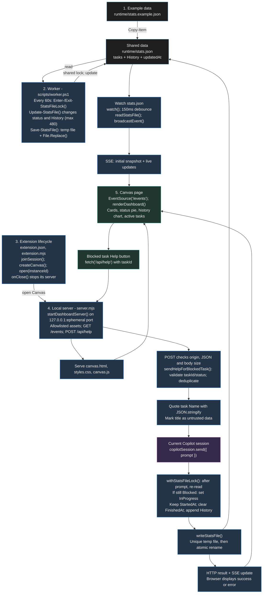

# Copilot Canvas Lab

This repository contains a workspace-scoped Task Monitor Canvas extension and a
PowerShell worker that updates its local mock task data.

## Run the Task Monitor

1. Copy the example data to the ignored runtime file:

   ```powershell
   Copy-Item .\runtime\stats.example.json .\runtime\stats.json
   ```

2. Start the mock worker in PowerShell:

   ```powershell
   .\scripts\worker.ps1
   ```

   It updates task statuses and history once per minute.

3. Reload workspace extensions in Copilot, then open the **Task Monitor** canvas.
   The dashboard receives live updates from `runtime\stats.json`.

Blocked tasks have a **Help** button. It sends the task title to the current
Copilot session as untrusted data and, after the prompt is accepted, changes
that task to `InProgress` while preserving `StartedAt` and clearing `FinishedAt`.

The extension is in `.github\extensions\task-monitor\`. It uses only Node.js
built-ins and the Copilot SDK supplied by the host; no project dependencies are
required. The generated `runtime\stats.json` is intentionally ignored by Git.

The worker and Canvas server coordinate writes with an ignored lock file.
If replacing the mock worker with a real API client, use a read-only service
identity, keep credentials outside the stats file and logs, validate API
responses, and send only task data that is appropriate for the current Copilot
session. Treat task names from the API as untrusted input.

## Task Monitor architecture and data flow

Read this flow from top to bottom. The worker runs separately; opening the
Canvas does not start it.



Blue nodes are files and services; green is the browser; purple is the Copilot call.

**Key names**

- **Worker:** `$statsFilePath` and `$statsLockPath` identify the data and lock;
  `$validStatuses` and `$statsData` describe the validation and current JSON;
  `$timestamp` and `$maxHistoryEntries` track updates and cap history at 480.
- **Server:** `statsFilePath`, `validTaskStatuses`, and `dashboardAssets` define
  the data, accepted statuses, and served-file allowlist. `eventStreamClients`,
  `statsBroadcastTimer`, `pendingHelpTasks`, and `statsFileLockPath` manage SSE,
  file-event debounce, duplicate Help requests, and write coordination.
- **Extension:** `dashboardServersByInstance` tracks per-instance servers;
  `copilotSession` sends Help prompts to the current session.
- **Browser:** `statsSnapshot` is the latest payload; `taskCounts` are derived
  totals; `pendingHelpTaskIds` keeps duplicate clicks disabled.

Data shape: each `tasks` entry has `ID`, `Name`, `Status`, `StartedAt`,
`FinishedAt`, and `Agent`; each `History` entry has `Time`, `Done`, and
`Blocked`. Worker and server use `runtime/stats.json.lock` to serialize writes.
The Help route broadcasts its update immediately; its file change may also
trigger the watcher, so the browser can safely receive the same snapshot twice.
